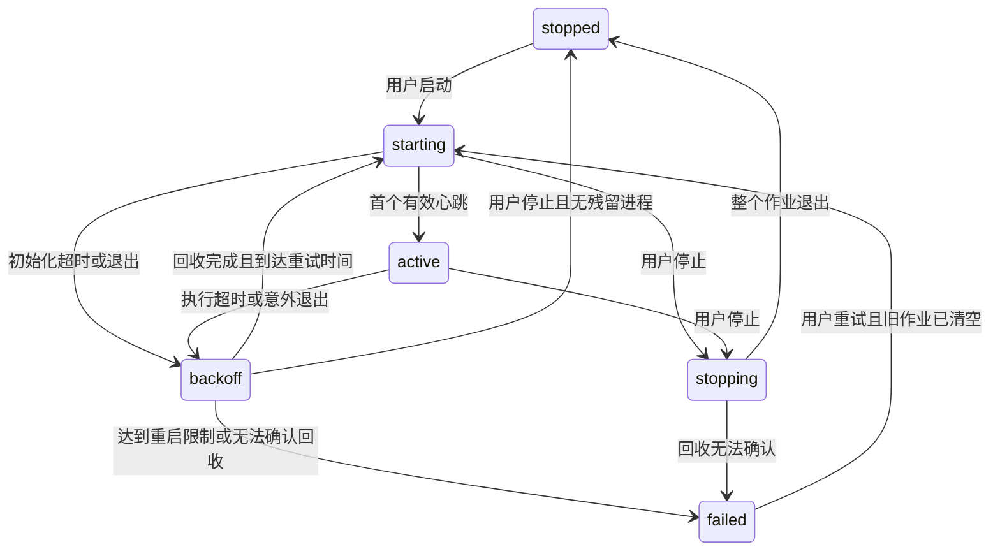

# 矿山视界主要问题修复设计

日期：2026-10-17  
状态：设计提案，尚未实施  
适用范围：当前 Windows 本地部署的 `analysis-service` 与 `kstool/mediamtx`

## 1. 目标与现状

本设计解决画面与检测框不同步、异常恢复不完整、进程误停、CPU 指标失真、告警重试语义不清和运行文件持续增长六类问题。沿用 Python、原生前端、SQLite、YOLO 和 MediaMTX，不引入新服务或新的推理框架。

2026-10-17 重新分析时的基线：

- 42 项自动化测试全部通过；项目内已包含 18 段视频及推流工具。
- 四路冒烟通过：77 条图片哈希校验、14 条人员检测结果、4 条入侵触发结果、7 条装备类别检测结果；检测数量不是去重人数。
- 断流隔离、重连、正常退出通过，但未覆盖进程卡死、控制台崩溃或完整看门狗重建。
- CPU 采样函数在计算负载下连续三次返回 0.0。
- 冒烟中的烟火任务产生了结果，不代表真实烟火识别准确率通过。

基线来源：`analysis-service/validation.json`、本轮测试输出和相关源码。后续测试会覆盖该 JSON，因此实施时应将基线报告复制到独立验收目录。

### 1.1 成功标准

1. 用户看到的检测框与显示图片来自相同 `frameId`；迟到请求不会覆盖新场景或新帧。
2. 初始化卡死、推理卡死、子进程退出均有明确终态或有界恢复；同路不出现重叠分析实例。
3. 停止一路、关闭控制台或停止模拟流，不影响其他项目进程。
4. CPU 指标基于同一进程的连续采样；未就绪与真实零负载可区分。
5. 永久失败告警不自动重试，临时失败可恢复；不同目标不被事件类型级冷却误吞。
6. 可再生运行文件有边界；业务证据和待处理告警不被自动清理。

### 1.2 边界与明确假设

- 保留本机单用户控制台、每路独立分析进程及 CPU 推理；GPU、多机调度、账号权限、模型重训不在范围内。
- 不改 Java 告警负载字段与现有 `alertCode` 算法；真实 Java 幂等行为仍需联调验证。
- 优先保证检测可解释性，允许分析画面帧率低于原视频播放帧率。
- 不假定历史业务证据允许删除。自动清理仅覆盖明确可再生的文件；业务留存期限由后续业务要求确定。
- 本文是可评审的设计，不执行数据删除、数据库迁移、部署或业务代码修改。

## 2. 方案取舍

| 方案 | 收益 | 代价 | 选择 |
|---|---|---|---|
| 在现有架构内修复一致性与生命周期 | 改动可分批验证，复用现有测试和数据 | 仍受 CPU 与图片轮询限制 | 本期采用 |
| 接入统一视频时间戳、WebRTC 与检测元数据同步 | 连续播放与框同步体验更好 | 涉及编码、缓冲、时间基准和前端播放链路 | 后续独立设计 |
| 更换 Web 框架、消息队列与进程平台 | 可支持更大部署规模 | 与当前规模不匹配，迁移风险高 | 本期不做 |

进程回收选择 Windows Job Object，而不是按进程名结束或仅枚举 PID。按名称范围过大；枚举子进程存在父进程退出、PID 复用及创建竞态。将同路进程归入专属作业对象，可以让生命周期边界与视频任务一致。

## 3. 分析画面与检测框一致性

### 3.1 当前根因

`console.js` 的 `preferVideo()` 在监控和查看器中优先播放原始视频，叠加层却来自后台分析结果；两者没有共享播放位置。`console.py` 又将各场景图片统一替换为最新 `live.jpg`，慢场景的旧框可能落到快场景的新图片上。

### 3.2 显示规则

- 有分析结果时，默认显示“分析画面”：使用该结果的 `snapshot` 和检测框。
- “原视频预览”作为本地视频的独立查看模式保留，不叠加检测框；模式切换不影响分析任务。
- 未分析时使用封面或现有原视频预览。网络流不在本期增加新的连续播放器。
- 告警详情保持使用独立保存的证据图和当时检测结果。
- 断流或分析结果过期时保留最后画面，明确标注采集时间与“画面已停更”，不能继续标示实时。

### 3.3 数据与文件约定

复用现有 `frameId`、`capturedAt`、`snapshot`、`detections` 和 `regions`。`latest[eventId].image` 必须指向自身的 `snapshot`，不再用 `live.jpg` 覆盖。`liveImage` 可以保留兼容，但不得作为分析框的背景。

截图以运行目录与帧序号唯一定位。写入顺序为：

1. JPEG 写入同目录临时文件，关闭文件后原子重命名为最终文件。
2. 构造包含该文件路径的结果记录。
3. 原子更新状态文件，使客户端只能看到已发布截图的结果。

前端先离屏加载该图片，成功后在同一次渲染提交中更新图片和 SVG。每个视图持有递增请求代次，回调必须同时匹配摄像头、场景、视图代次与目标 `frameId`。切换场景、关闭弹窗或重建卡片都会使旧代次失效。

加载失败时保留上一对匹配的图片和框，展示刷新失败；不能只更新框。新结果未提交前不能改动可见结果元数据。

### 3.4 帧清理保护

保护所有场景当前 `latest` 引用的帧；其余普通帧按最后写入时间至少保留 60 秒，避免现有“300 个源帧”在高源帧率下造成短暂读取窗口。过期浏览器请求可返回 404 并刷新状态，不承诺永久保留普通帧。告警图不受此规则影响。

### 3.5 验收

- 两个场景分别每 0.2 秒和 2 秒推理，均只显示自身帧。
- 注入图片请求乱序，旧响应不得覆盖新场景；失败图片不得产生新框旧图。
- 原视频预览始终不显示检测框；告警详情保持历史证据。
- 合成视频包含可读帧序号与移动目标，人工检查与前端自动检查均验证图片、框和帧编号一致。

涉及文件：`console.js`、`console.py`、`service.py`，以及对应前后端测试。

## 4. 分析进程生命周期与故障恢复

### 4.1 进程所有权

新增小型 `analysis-service/process_scope.py`，只封装 Windows 进程组的创建、等待和回收，不承载视频业务。每路任务一个 Job Object，控制台持有其不可继承的句柄；`service.py` 与派生分析进程都在该作业内。

Windows 作业对象支持关联进程及其默认继承的子进程；设置 `JOB_OBJECT_LIMIT_KILL_ON_JOB_CLOSE` 后，关闭最后句柄会终止作业内进程。参考：[Microsoft Learn：Job Objects](https://learn.microsoft.com/en-us/windows/win32/procthread/job-objects)。

启动必须采用“挂起创建 → 加入作业 → 恢复执行”，禁止先运行服务再补加作业，以免服务提前派生不受控子进程。优先用标准库 `ctypes` 封装必要系统调用；不依赖 `subprocess` 的私有线程句柄。创建、分配或恢复任一步失败，终止本次挂起进程、关闭句柄并报告启动失败。作业分配失败时不能降级为裸进程运行。

不设置允许子进程脱离作业的标志，作业句柄不传给子进程。控制台意外退出后，不能因为子进程继承了句柄而继续保持作业存活。

控制台启动时按规范化数据目录获取 Windows 命名互斥量，整个会话持有；另一控制台使用同一数据目录时拒绝启动。不同数据目录可独立运行。这样单发送者约束不会被第二个控制台绕过。

本期 Windows 行为必须完整验收；不宣称已提供同等 Linux 保障。

### 4.2 控制状态与采集状态分离

`jobs[cid]` 新增控制字段：

| 字段 | 含义 |
|---|---|
| `desiredRunning` | 用户是否仍希望该路运行 |
| `generation` | 本次进程组代次，阻止旧退出结果覆盖新任务 |
| `lifecycle` | starting、active、stopping、backoff、failed、stopped |
| `startedMonotonic` | 本次启动单调时间 |
| `lastProgressMonotonic` | 控制台最后观察到心跳序号前进的单调时间 |
| `restartHistory` | 最近十分钟自动重启时间 |
| `nextRestartMonotonic` | 下一次允许重启时间 |
| `lastFailure` | 初始化超时、执行超时、意外退出、回收失败等原因 |

现有 `state` 继续描述连接、重连与运行，API 增量返回 `lifecycle`、`lastFailure` 和下次恢复时间。页面不得把 `backoff` 显示成正常运行。

### 4.3 心跳与恢复规则

- 初始化期限建议 60 秒，从进程启动时开始计时；没有状态文件也会超时。
- 初始化完成后，工作循环增加递增 `heartbeatSeq`，仍保留 UTC 时间用于展示。控制台用“序号是否前进”和本地单调时间判断存活，不依赖系统时钟差值。
- 保留 `KUANGSHAN_WATCHDOG_SECONDS`，默认 30 秒。心跳必须由实际工作循环推进，不能由独立定时线程掩盖推理卡死。
- 视频断线但循环仍活跃时，继续由现有取流重连处理，不触发进程重建。
- `desiredRunning=true` 时服务退出，即使退出码为 0，也视为意外退出。
- 故障后先回收整个旧作业并确认活动进程为零，再安排重启；无法确认则进入 `failed`，禁止叠加新实例。
- 自动恢复退避为 1、2、5、10、30 秒；十分钟内最多自动重启 5 次，下一次故障进入 `failed`。人工启动可重置预算；稳定运行十分钟后清空预算。
- starting、active、stopping、backoff 均占用并发名额，避免故障路同时恢复突破 `MAX_RUNNING`；只有作业确认清空的 stopped/failed 释放名额。

### 4.4 停止与竞争处理

用户停止时先在锁内设置 `desiredRunning=false` 并取消重启，随后发出当前 STOP 请求。正常退出等待上限 18 秒，超时终止整个作业，再最多等待 3 秒确认归零。没有运行目录时也必须能通过作业回收。

锁只保护状态迁移，不持锁执行进程等待、磁盘扫描或长时间网络操作。等待后重新检查代次再写回状态。启动、停止、删除和看门狗共用同一套迁移方法。

控制台关闭先停止看门狗并等待其结束，再停止全部作业；不能边关闭边启动新任务。正常关闭尽力排空 outbox，异常退出依赖持久化恢复，不承诺排空。

### 4.5 验收

- 模型加载前卡住且无心跳，初始化期限后恢复或明确失败。
- 推理工作循环卡死，30 秒阈值加一次 5 秒检查周期内被发现。
- 服务进程、分析子进程分别异常退出，旧作业归零后才能创建下一代。
- 用户停止与看门狗同时发生，不再自动启动。
- 控制台被强制结束，其拥有的分析作业消失；独立测试哨兵进程不受影响。
- 达到重启预算后停止自动尝试，错误原因可见。
- 真进程测试检查 PID、创建时间和作业成员；不能仅用 `FakeProcess` 验证。

## 5. 模拟流的安全启停

保留三个批处理入口，内部统一调用新增 `kstool/mediamtx/stream_control.py`。用项目相对路径寻找现有 Python 环境；找不到时明确报错，不安装软件或结束其他进程。

`stream_control.py` 的常驻管理进程持有一个专属作业，MediaMTX 及其 FFmpeg 子进程归入其中，复用 `process_scope.py`。轻量版与完整版共享一个项目实例锁，同一项目不能重复启动两组。

运行信息写入 `kstool/mediamtx/runtime/session.json`，只记录实例标识、管理进程 PID、创建时间、规范化项目路径和启动模式，不包含视频账号。停止请求用该实例目录的 STOP 文件传递；管理进程负责回收作业并确认退出。

停止命令验证实例锁、路径和进程身份；管理进程卡死时，仅可终止经过 PID、创建时间、可执行路径及管理脚本路径验证的该管理进程，由作业关闭回收子树。身份无法确认时拒绝强制终止并报错。删除所有按进程名或窗口标题批量结束的命令。

端口被别的实例占用时直接报冲突，不尝试释放对方端口。没有有效运行记录时停止返回“当前项目没有运行中的模拟流”。

验收：额外启动一个无关 FFmpeg 和一个无关 MediaMTX 哨兵，停止本项目后两者仍存活；连续启停、管理进程崩溃、重复启动和伪造过期 PID 均覆盖。

## 6. CPU 指标修正

每个分析进程在初始化时创建一次 `psutil.Process()`，先预热 `cpu_percent(interval=None)`，之后复用对象，每秒采样一次。状态文件可以更频繁发布，但复用最近一次完整资源采样。

新增 `sampledAt` 和 `available`；首个有效间隔前 `cpuPercent=null`、`available=false`。异常采样也返回不可用，不填充假零值。

CPU 百分比保留 psutil 的进程口径：100% 约为占满一个逻辑核，多线程可以超过 100%。界面注明口径，不误画成最高 100% 的整机使用率。

聚合仅统计有效样本，同时返回 `sampledRunning` 与 `running`；有缺失样本时标注“部分进程未采样”。内存数值只代表分析进程，不宣称包含全部 Python 服务、模拟流与系统开销。

验收：预热后连续计算负载至少 2 秒，至少一个有效采样大于 0；随后空闲采样下降；不设依赖硬件的精确百分比断言。原先聚合测试继续保留，并新增采样对象生命周期与空值测试。

涉及文件：`service.py`、`console.py`、`console.js`、`tests/test_capacity.py`。

## 7. 告警可靠性与状态语义

### 7.1 重试状态

现有 outbox 表增量增加 `state`、`last_error`、`updated_at`，`state` 取 `pending` 或 `dead`。成功后仍删除队列行，以减少对现有流程的改动。

| 结果 | 处理 |
|---|---|
| 2xx | 按现有 HTTP 成功约定完成并删除队列行 |
| 超时、连接错误、429、5xx | 保持 pending，按现有 1/2/5/10/30 秒退避 |
| 其他 4xx、被拒绝的重定向 | 标记 dead，不再自动重试 |
| 证据缺失、负载无法解析 | 标记 dead，保留原因和原始记录 |
| 本地 SQLite 暂时不可用 | 上报线程退避后重试，状态可见，不能静默退出 |

`_claim()` 只选择到期 pending。`_claim()` 本身也纳入异常保护。每个摄像头 outbox 同时只能有一个发送者，由进程所有权保证；不为未要求的分布式发送增加租约协议。

保证至少一次投递，不宣称网络层恰好一次。服务端已接收而本地未删行时会重发相同 `alertCode`，Java 必须按该编号幂等。若 Java 在 2xx 中另有业务失败字段，应在真实接口契约确认后单独补充解析，不能臆造响应结构。

界面分开显示：本次启动发送成功数、本次启动失败尝试数、持久化待发送数、持久化待处理数。停止或重启后，不将旧快照计数描述为全历史累计。

pending/dead 数量由控制台直接读取 outbox，而不是依赖已停止工作进程的状态快照。增加有界待处理列表接口 `GET /api/alerts/outbox?cameraId=...&state=dead&limit=50&offset=0`，返回行编号、事件类型、错误摘要和更新时间；限制每页最多 100 行，沿用本机访问校验，页面提供指定行重试入口。错误摘要不得包含凭据或完整带认证信息的视频地址。

### 7.2 冷却规则

业务告警冷却统一由 `Engine.collect()` 中任务、区域、目标维度负责；上报器不再按事件类型额外丢弃已被业务层接受的事件。传输去重使用现有稳定 `alertCode`。

保留任务 `cooldown` 语义。修正跟踪编号为空时的回退：使用 `trackId` 的非空值，否则回退类别；无跟踪编号时只能按类别冷却，界面与文档说明这一限制，不伪造目标身份。

`KUANGSHAN_ALERT_COOLDOWN_SECONDS` 在本版本弃用，启动时若检测到旧配置，显示迁移提示并忽略它；不静默维持双层冷却。该变更可能增加实际发送数量，验收需覆盖同类不同目标连续触发。

入队以整条本地事件的所有目标为一个事务。容量不足时保留本地事件并返回明确“未入队”结果；页面显示该错误，不使用“告警绝不丢失”描述。自动补偿本地事件与 outbox 之间的崩溃窗口不在本期保证范围内。

### 7.3 人工重试与迁移

新增 `POST /api/alerts/retry`，参数为摄像头编号和 outbox 行编号，复用 Host、Origin、令牌校验。只允许将 dead 改为 pending、清零尝试次数并立即到期；保留原编号与证据。重复请求不重复插入。

对应摄像头未运行时，重试记录保持 pending，明确提示“下次启动分析后发送”。不为此新增独立后台发送服务。

迁移前停止全部相关发送者并使用 SQLite 原生备份；通过表结构查询幂等增加列，旧行默认 pending。旧版本无法可靠区分永久错误，因此历史失败行可能在新版本首次发送后才转为 dead，需记录这一次兼容行为。

降级时不能直接用旧程序读取含 dead 的新队列，否则旧程序会重新发送这些记录。回滚需停止发送者并恢复整套迁移前数据库备份；若迁移后已有新业务数据，先导出保存，完成合并方案后再恢复，禁止覆盖丢失。

### 7.4 验收

- 400 与 401 只发送一次；推进模拟时间超过一小时仍不发送。
- 429、500 和超时继续重试；重启后队列继续发送，编号不变。
- 人工重试只激活指定记录；未运行摄像头不虚报已发送。
- 同类不同目标连续产生两条已接受事件，两条都能入队。
- 证据缺失和坏 JSON 可定位，不使发送线程退出。
- 容量满、SQLite 暂时锁定和迁移重复执行均覆盖。

## 8. 存储边界与安全清理

新增 `analysis-service/maintenance.py`，只管理明确归本项目所有的运行文件，支持预览与执行两种模式。默认仅允许清理下表中的可再生数据，业务证据保留。

| 数据 | 本期策略 |
|---|---|
| 当前场景 latest 引用帧 | 始终保护 |
| 其余普通分析帧 | 至少保留 60 秒，之后清理 |
| 当前运行 results/events 日志 | 单文件 20 MiB，最多保留 5 个轮转文件 |
| 已结束运行目录及冒烟目录 | 保留 7 天；活动目录永不删除 |
| 无摄像头引用的封面 | 保留 24 小时后清理 |
| outbox 截图 | pending/dead 任一行引用即保留；无引用至少 24 小时后清理 |
| 本地事件数据库与 evidence | 本期不自动删除 |
| Java 上传目录 | 不自动清理，由接收方留存规则管理 |

未开始执行的配置、运行目录、封面令牌也可能处于创建窗口；清理使用年龄保护，并在删除前重新检查引用与活动代次。outbox 文件清理与入队使用同一 SQLite 文件的 `BEGIN IMMEDIATE` 事务串行化：入队在复制截图前获取写锁，插入后提交；清理在获得写锁后重新检查引用，再删除无引用候选并结束事务。文件批次保持小而有界，锁超时则跳过本次清理，不能用仅进程内的线程锁替代跨进程互斥。

结束运行目录仍可能被停止状态页面引用。删除该目录前，清空对应过期 `latest` 并回退到封面；历史告警继续通过独立 evidence 访问。包含未知数据库、证据或待发送引用的目录不视为可再生目录；冒烟目录仅在确认属于测试且无待发送记录时可清理。

目录删除前规范化绝对路径，确认严格位于指定根目录内；拒绝符号链接、Windows junction、其他 reparse point 和不符合运行目录命名规则的目标。未知目录只报告，不删除。数据库、权重、源视频均不在删除白名单内。

控制台每十分钟执行一次有限批次清理，每批最多 100 个候选；文件被占用时记录并跳过。数据库引用检查失败时停止本批清理，不能将“查询失败”解释为“没有引用”。预览模式输出候选路径、大小和删除依据，不改动文件。

对数据目录，以及启用上报时的上传目录所在卷分别检查剩余空间：低于 5 GiB 提示，低于 1 GiB 拒绝启动新分析，并让现有任务进入可见的存储故障停止流程；待发送记录保留，不能通过删除业务证据腾空间。空间恢复后要求用户重新启动，避免自动重启循环。

不宣称整体磁盘占用已硬封顶：业务证据仍会增长；本期提供可再生数据边界、占用报告和低空间保护。

验收：保护 active/latest/pending/dead 引用；注入目录穿越与 junction；清理期间入队；模拟低空间；重复执行幂等；不读取或修改真实业务数据库进行破坏性测试。

## 9. 改动范围与实施顺序

| 批次 | 文件范围 | 交付与退出条件 |
|---|---|---|
| 1 | `console.js`、`console.py`、`service.py` | 帧与框一致；乱序和多间隔场景通过 |
| 2 | `process_scope.py`、`console.py`、`service.py` | 完整进程回收与状态机；真进程故障注入通过 |
| 3 | `stream_control.py`、三份启停 bat | 项目专属启停；无关进程不受影响 |
| 4 | `service.py`、`console.py`、`console.js` | 有效 CPU 采样及可用性显示 |
| 5 | `alerts.py`、`console.py`、`console.js` | dead 状态、人工重试、冷却迁移与数据库备份回滚验证 |
| 6 | `maintenance.py`、`service.py`、`console.py` | 清理预览、安全删除、日志轮转和低空间保护 |
| 7 | `tests/`、`smoke_test.py`、两份 README | 回归、故障注入、长时间运行报告与准确的能力说明 |

每批先写能复现目标问题的测试，再最小实现；原有 42 项全部保持通过。确因新规则变化的测试必须说明替代行为，例如“缺失截图删除”改为“保留 dead 记录”，不能简单移除断言。

新增模块仅隔离 Windows 生命周期、模拟流管理和存储维护三个明确职责；不拆分其他稳定模块，不改模型类别、阈值或权重。

## 10. 联合验收与发布边界

### 10.1 分层验证

1. 单元测试：帧映射、代次判断、恢复预算、CPU 采样、队列状态及清理候选判断。
2. Windows 集成测试：真实父子进程、父进程崩溃、卡死、停止竞争、无关进程存活；所有进程使用专属临时目录和动态端口。
3. 浏览器验证：网络延迟与乱序、切换场景、图片失败、原视频预览、告警证据。
4. 既有四路冒烟：断流隔离、重连、真实人员与入侵、图片哈希、正常退出。
5. 稳定性验收：选定机器上六路固定视频、固定场景组合连续 8 小时，记录硬件、素材分辨率、任务间隔、依赖版本；每路每秒汇总结果速率、结果年龄、CPU、内存、重启次数、队列数与磁盘占用。结果年龄定义为查看时刻减 `capturedAt`，当前字段表示本机解码取帧时刻，不把它称为摄像头采集到显示的完整端到端延迟。

长时间验收通过条件：无未处理异常、无重复工作进程、无错误删除、可再生日志符合轮转限制、所有模拟断线恢复；图片与框始终匹配。若某路结果年龄的 P95 超过 3 秒，则该场景组合不满足本期实时目标，应降低并发或增加任务间隔并重新记录配置，不能仅以进程存活判定通过。

准确率另用带标注的现场正负样本评估。人员、装备、烟火分别统计漏报与误报；没有业务阈值和标注集时只报告测量结果，不写“准确率合格”。

### 10.2 数据与回滚

- 本期实现与验证均先在临时数据目录完成，不覆盖 `data/events.db` 或现有 outbox。
- 发布前保存代码版本、现有配置、数据库原生一致性备份及本轮验收报告。
- UI 同步、CPU 统计可以按批次代码回退；进程生命周期回退前必须停净所有新版本管理的作业。
- outbox 迁移按第 7.3 节回滚，禁止让旧发送器直接消费新状态。
- 清理执行不可逆，所以必须先验证预览列表和保护规则；无需删除的数据不纳入回滚承诺。
- 当前工作区未检测到 Git 仓库；实施前应明确版本保存方式，不能把不存在的提交或标签作为回滚依据。

## 11. 设计决策清单

| 决策 | 本文推荐值 | 影响 |
|---|---|---|
| 监控展示 | 匹配帧为默认，原视频预览不叠框 | 牺牲部分流畅度，获得可解释性 |
| 初始化超时 | 60 秒 | 极慢机器可能需要调整并验证 |
| 自动恢复预算 | 十分钟最多 5 次 | 持续故障会停在 failed，需人工处理 |
| 上报冷却 | 业务层统一负责，弃用桥接层冷却变量 | 同类不同目标发送量可能增加 |
| 历史业务证据 | 不自动删除 | 需要占用监控与后续留存政策 |
| 永久失败 | dead 保存，人工重试 | 可追踪处理，但需运维关注 |

以上为完整的推荐设计取舍，实施前可按主人的反馈调整。本文交付不代表这些行为已经实现，也不包含发布授权。
